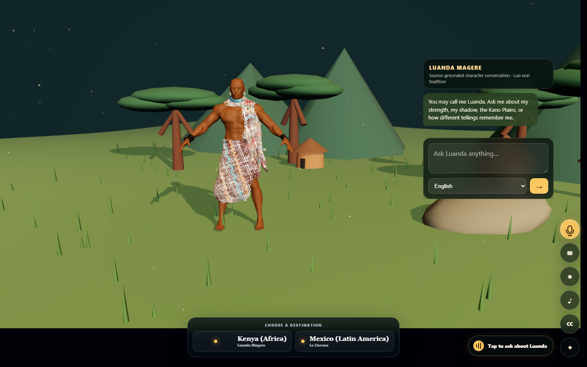
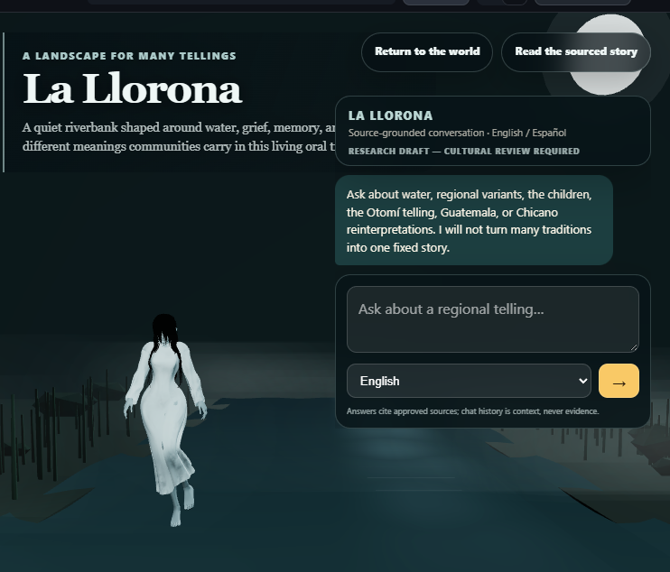

# Hadithi

Hadithi is an immersive, source-aware oral traditions portal. Its launch
experiences are:

- **Luanda Magere — Kenya, Africa**
- **La Llorona — Mexico and Latin America**

Visitors enter a legend's landscape, ask questions by text or microphone, and
see the sources and regional tellings behind each answer.

## Experience preview



*Luanda Magere speaks in the first person from the Kano Plains experience, with
text, microphone and destination controls kept visible.*



*La Llorona appears in the river environment beside the English/Spanish chat,
with the cultural-review status visible in the interface.*

## Current prototype

- Three.js globe journey with labelled Kenya and Mexico destination cards
- User-triggered procedural airship engine, wind, arrival, plains and river audio
- Kano Plains landscape with a licensed, rigged Luanda Magere character,
  moving sunlight and shadow
- La Llorona moonlit riverbank with water, mist, reeds, procedural ambience,
  an animated character, and bilingual source-grounded text conversation
- First-person, source-grounded Luanda Magere conversation in English and Kiswahili
- First-person La Llorona conversation in English and Spanish
- Reviewed conversational handling for greetings, identity, help and goodbyes
- Bounded conversation memory for natural follow-up questions
- La Llorona narrative and source registries
- UNAM, Smithsonian, Guatemalan government, folklore scholarship, historical
  association, and explicitly labelled Wikipedia context
- Strict structured-output and citation validation
- Reviewed deterministic answers when generation fails
- faster-whisper voice-question transcription in English, Kiswahili, and Spanish
- Optional ElevenLabs narration
- Procedural Web Audio ambience
- Installable PWA shell

## Model configuration

Hadithi supports OpenAI-compatible chat-completions providers:

```powershell
$env:LLM_API_KEY = "<private-provider-token>"
$env:LLM_API_URL = "https://api.cloudflare.com/client/v4/accounts/<account-id>/ai/v1/chat/completions"
$env:LLM_MODEL = "@cf/meta/llama-3.2-3b-instruct"
```

The current Render configuration targets Cloudflare Workers AI. A local Gemma
model can be used through Ollama:

```powershell
$env:LLM_API_KEY = "ollama"
$env:LLM_API_URL = "http://127.0.0.1:11434/v1/chat/completions"
$env:LLM_MODEL = "gemma3:4b"
```

Generated source IDs are checked against each legend's approved registry before
citations are displayed. Provider failures fall back to reviewed source
responses.

## Voice

Voice questions use the CPU-friendly faster-whisper `base` model with INT8
inference. Natural narration remains optional:

```powershell
$env:ELEVENLABS_API_KEY = "<private-api-key>"
$env:ELEVENLABS_VOICE_ID = "<voice-id>"
```

Without narration configuration, answers remain available as chat and captions.
The public experience remains text-first until spoken character voices meet the
project's quality, consent and cultural-review requirements.

## Run locally

```powershell
py -3.13 -m pip install -e ".[dev,ai]"
py -3.13 -m uvicorn app.main:app --reload --host 127.0.0.1 --port 8000
```

Open `http://127.0.0.1:8000`.

The root URL opens the interactive world portal directly; `/portal` remains an
alias for the same experience. The introduction and project principles are
available at `/about`, and the sourced reading pages remain under `/legend/`.

Character replies use a friendly, everyday first-person tone, without invented
memories or cultural details. Short greetings and reviewed fallback responses
also use conversational language. Source validation and regional safeguards
remain unchanged; generated phrasing can vary by model.

## Deploy to Render

`render.yaml` provisions one Frankfurt web service on the `1c-2g` compute plan.
The build installs Hadithi and pre-downloads the faster-whisper `base` model.

When Render creates the Blueprint, provide:

```text
LLM_API_URL=https://api.cloudflare.com/client/v4/accounts/<account-id>/ai/v1/chat/completions
LLM_API_KEY=<private-workers-ai-token>
```

The Cloudflare token is entered only in the Render dashboard and is never
committed to the repository.

## 3D asset credit

["African Warrior"](https://skfb.ly/68YLs) by
[avenirdesign](https://sketchfab.com/avenirdesign) is licensed under
[Creative Commons Attribution 4.0](http://creativecommons.org/licenses/by/4.0/).

## La Llorona experience

`/portal/la-llorona` combines the moonlit river environment with a bilingual
English/Spanish text chat. The endpoint at
`/api/legends/la-llorona/ask` uses only `app/content/la_llorona.json` and the
approved core entries in `app/content/la_llorona_sources.json`. Recent chat is
bounded and supplied only as conversational context, never as evidence.

The source registry deliberately remains marked
`research_draft_requires_cultural_review`. Regional variants are preserved
rather than flattened into a single biography, and Wikipedia appears as
`Wikipedia contributors` with its community-edited role made explicit.

The approved GLB is loaded into `LaLloronaCharacterAnchor`, normalized to the
scene, and plays `Mournful_Idle`. If loading fails, the riverbank keeps a visible
neutral silhouette and reports the failure without blocking the experience.

### La Llorona character attribution

This work is based on "ghost_lady_wipppookgtygv" by Blakosad, licensed under CC BY 4.0.

- Source: https://sketchfab.com/3d-models/ghost-lady-wipppookgtygv-7cab2c0c6f1541fb8354dc08b5b868f4
- Short link: https://skfb.ly/oQvKF
- License: https://creativecommons.org/licenses/by/4.0/
- Repository metadata: `app/static/models/la-llorona-model.json`

## Next steps

- Deploy the public Render service and record a short two-destination demo.
- Evaluate a hosted Gemma endpoint as the primary production model, while
  keeping the current provider-neutral validation and deterministic fallbacks.
- Add optional, natural spoken character responses without removing text chat
  or captions.
- Test voice quality, pronunciation, consent and cultural appropriateness with
  relevant community reviewers before enabling character speech by default.
- Complete cultural review of the La Llorona research draft and regional
  safeguards.
- Compress and optimize the 3D models and textures for slower mobile networks.
- Validate the complete journey on a wider range of phones and accessibility
  settings.

## Test

```powershell
py -3.13 -m pytest
```
