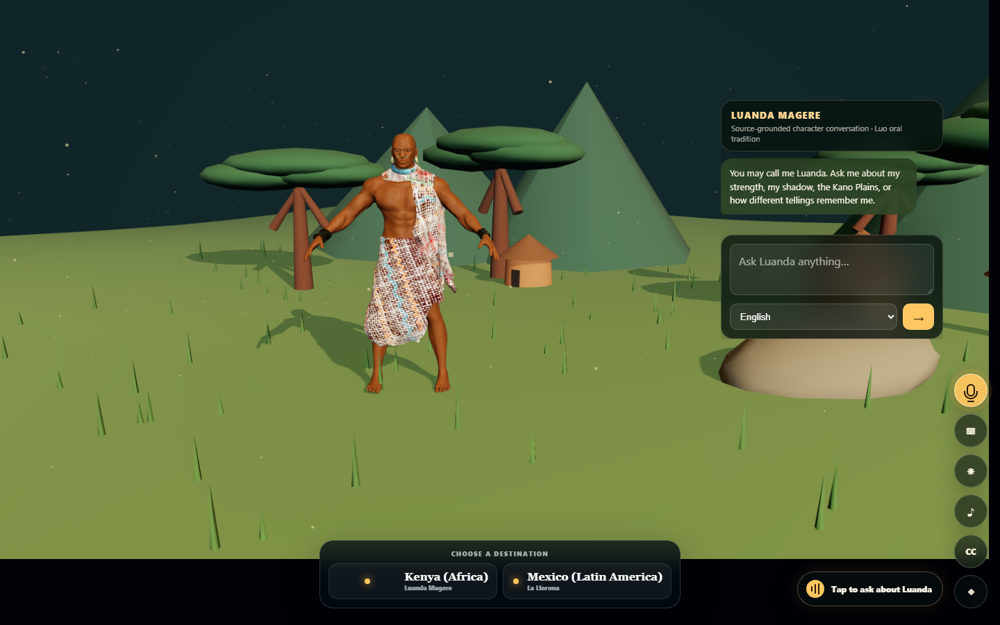
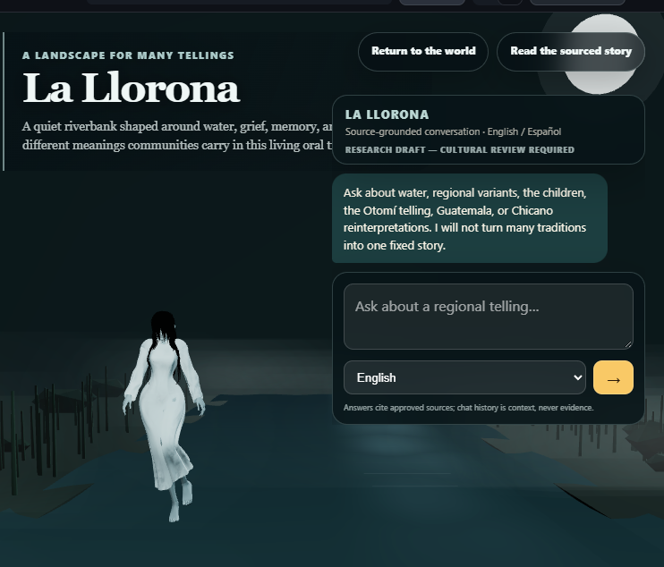

# Hadithi: When Legends Speak Back

*This is a submission for the* [*Hacktoberfest Open-Source AI Challenge Week 4: Ghost in the Machine*](https://dev.to/challenges/hacktoberfest-week4-2026-10-26)

## What I Built

In my community, stories have always been passed down through oral narratives.
Many would sit by the fire and listen to the stories of old, told from one
generation to another. The fire was not only a source of warmth. It became a
place where children learned who they were, where elders were heard, and where
people who had lived long before us could still feel close.

With changing times—and even a changing climate—sitting together by the fire
has become less attainable. When those moments disappear, we risk losing more
than stories. We can lose names, warnings, humour, courage, and the small
details that connect us to where we come from.

I kept wondering: if our gathering places are changing, can we create a new
kind of place where these stories can still be encountered?

That question became Hadithi, an immersive portal into oral tradition.
Visitors do not simply read a summary. They enter a legend's landscape, meet
the character through a source-grounded first-person conversation, and ask
questions using text or their voice.

The portal now opens onto two complete destinations:

- **Kenya (Africa)**, where visitors travel to the Kano Plains and speak with
  **Luanda Magere** from Luo oral tradition;
- **Mexico (Latin America)**, where visitors enter a moonlit river landscape
  shaped around the regional tellings of **La Llorona**.

The world view does not hide these behind an abstract globe. It presents clear
destination cards, marks both locations, and lets the visitor choose where the
journey should go. A short procedural airship-like engine and wind sound begins
after the visitor clicks, giving the transition a sense of departure without
using a copyrighted audio asset.

I interpreted "Ghost in the Machine" as the trace of a story that remains
present because people continue to tell, question, reinterpret, and remember
it. Hadithi does not claim that a generated character is the historical person
or that every supernatural event is verified fact.

The completed experience includes:

- a full-screen Three.js world gateway with Kenya and Mexico destinations;
- user-triggered procedural airship audio during departure;
- two independently designed legend landscapes;
- a licensed 3D warrior representing Luanda Magere;
- a moving sun and physically changing shadow connected to the legend;
- a licensed, adapted and rigged La Llorona character with a looping
  `Mournful_Idle` animation;
- conversational text panels beside each character;
- microphone recording and faster-whisper transcription;
- English, Kiswahili and Spanish interfaces where appropriate;
- mixed-language question understanding;
- source-grounded generation with Llama 3.2 through Cloudflare Workers AI;
- strict JSON-schema and citation validation;
- reviewed deterministic answers when generation fails;
- visible provider status and source links;
- independent procedural soundscapes for the Kano Plains and riverbank.

Both characters speak in the first person while their factual answers remain
restricted to approved sources. La Llorona is visibly marked as a **research
draft requiring cultural review**, and the experience does not merge regional
tellings into one universal biography.



*Luanda speaks in the first person beside text, microphone and destination
controls. Answers remain constrained to the reviewed Luo source pack.*



*The adapted character preserves the rig and restrained `Mournful_Idle`
animation. The bilingual chat keeps the cultural-review status and source
grounding visible rather than presenting one regional telling as universal.*

## Demo

- **Live demo:** Coming after the Render deployment.
- **Video demo:** Coming soon.

The demonstration can now show:

1. choosing Kenya or Mexico from the world view;
2. hearing the procedural airship transition after departure;
3. arriving in the Kano Plains and moving Luanda's shadow with the sun;
4. asking Luanda a question by microphone or text;
5. returning to the world and travelling to La Llorona's riverbank;
6. asking about the Otomí or Guatemalan telling in English or Spanish;
7. receiving an answer with visible approved citations;
8. enabling the independent landscape ambience.

## Code



The main implementation areas are:

- `app/main.py` — FastAPI routes, grounded generation, schema validation and
  deterministic fallbacks;
- `app/static/portal.js` — Three.js scene, character interaction, chat,
  world destinations, airship transition audio, conversation memory,
  microphone recording and Kano Plains ambience;
- `app/static/la-llorona-environment.js` — moonlit river, adapted character,
  bilingual chat and procedural river ambience;
- `app/services/transcription.py` — faster-whisper CPU transcription;
- `app/content/luanda_magere.json` — approved narrative passages;
- `app/content/luanda_magere_sources.json` — source registry and editorial
  safeguards;
- `app/content/la_llorona.json` and `app/content/la_llorona_sources.json` —
  regional narrative pack, source registry and cultural safeguards;
- `scripts/adapt_la_llorona_model.py` — reproducible Blender adaptation and
  idle-animation export;
- `tests/test_app.py` — grounding, fallback, conversation and route tests.

## How I Built It

### The immersive portal

The browser begins with a globe suspended in a dark portal. Two readable
destination cards sit below it:

- **Kenya (Africa) — Luanda Magere**
- **Mexico (Latin America) — La Llorona**

Choosing Kenya moves the camera toward the world and reveals the Kano Plains.
Choosing Mexico opens a separate moonlit river environment. Both journeys begin
with a short Web Audio transition built from filtered noise and oscillators. It
sounds like an airship engine, rising wind and an arrival tone, but no audio
file is downloaded and autoplay rules are respected because the sound begins
from the visitor's click.

Luanda faces the visitor beside a chat surface. The moving sun changes the
direction of his shadow, turning a central part of the legend into something
the visitor can explore.

La Llorona stands farther downriver with her `Mournful_Idle` animation. Mist,
reeds, reflections and restrained moonlight build the atmosphere without
turning the experience into a generic horror scene. Her conversation remains
text-first because the available synthetic voices did not sound natural enough
for the character.


### Voice input

Visitors can type a question or record it using `MediaRecorder`. FastAPI sends
the recording to the open faster-whisper `base` model using CPU INT8 inference.

During local measurement:

- the first transcription completed in approximately 8.54 seconds;
- a warm transcription completed in approximately 4.67 seconds.

Natural spoken output is intentionally disabled until a reliable neural
text-to-speech provider is available. I preferred readable chat over silently
falling back to a robotic browser voice.

### Open-model conversation

The live experience currently uses
`@cf/meta/llama-3.2-3b-instruct` through Cloudflare Workers AI's
OpenAI-compatible endpoint.

For each question, Hadithi sends:

1. the current question;
2. a bounded recent conversation history;
3. approved cultural-source passages;
4. instructions to preserve uncertainty and oral variants;
5. a strict schema for the answer, source IDs, topic and gesture.

Conversation history provides context but is explicitly excluded as factual
evidence.

The model successfully understood mixed-language input such as:

> "Yeah, alikuwa ametoka wapi?"

The selected interface language controls whether Luanda responds in English or
Kiswahili.

### Grounding and validation

Hadithi checks every returned source ID against an approved registry. A model
answer cannot display an invented citation.

If the model returns invalid structured data, cites an unapproved source,
claims grounding without evidence, times out, or becomes unavailable, the
server returns a reviewed deterministic response. The interface visibly tells
the visitor when this happens.

The Luanda source pack includes material associated with:

- National Museums of Kenya and Google Arts & Culture;
- Kisumu County;
- University of Nairobi scholarship on heroic traditions;
- University of Nairobi research on orature, heroism and gender.

For La Llorona, Hadithi is building a broader regional source pack using UNAM
research, the Smithsonian Latino Center, Guatemala's Ministry of Culture,
folklore scholarship, historical associations, and Wikipedia. Wikipedia is
identified as a community-edited source in the model context and in displayed
citations rather than being presented as equivalent to peer-reviewed research.

### Architecture

```text
Browser
  |- Three.js: destination globe, Kano Plains and moonlit river
  |- Characters: Luanda Magere and animated La Llorona
  |- MediaRecorder: voice questions
  |- Web Audio API: airship transition and procedural ambience
  `- Chat: conversation, citations and provider status

FastAPI
  |- separate approved source packs for each legend
  |- bounded conversation context
  |- strict generation and citation validation
  |- reviewed deterministic fallbacks
  `- faster-whisper transcription

Cloudflare Workers AI
  `- @cf/meta/llama-3.2-3b-instruct
```

### Learning through provider failures

The final architecture came from several failed experiments:

- Hugging Face reached Gemma but required inference credits;
- free OpenRouter Gemma providers returned capacity errors;
- Cloudflare authenticated correctly, but the selected Gemma model was not
  available to the account;
- Llama initially returned prose instead of the required JSON;
- a public Chatterbox narration service returned upstream failures.

I switched to an available Llama model, enabled strict structured output, kept
provider failures visible, and retained reviewed answers for core questions.

## Why Does Open Innovation Matter?

Open models make it possible to build this experience without making one
closed provider the permanent owner of its future.

The grounding layer, source registry, validation rules and deterministic
answers remain part of Hadithi. The conversational model can be hosted through
Cloudflare, another compatible provider, or eventually on
community-controlled infrastructure.

That matters for cultural technology. A school, museum, archive or community
should be able to inspect how a story is represented, replace a model, improve
the source pack, and challenge an interpretation.

Open innovation also made failure visible. Instead of disguising unavailable
providers or unsupported answers, Hadithi can explain what happened and
continue with reviewed material.

## My Agent Session

<!-- Add the DevRelay agent_session embed or session link before publishing. -->

GitHub Copilot helped me iterate through the Three.js experiences, transcription
pipeline, provider integrations, structured-output failures, citation checks,
conversation memory, Blender character adaptation, mobile layout and test
coverage.

The useful part of the agent workflow was not receiving one perfect generated
solution. It was being able to test assumptions, inspect failures, replace
unreliable providers and preserve the decisions that made the experience safer.

## The Spirit of It

The moment the project landed for me was not when the model produced its first
answer. It was when the world stopped being a decorative globe and became a
choice: Kenya or Mexico, the Kano Plains or a moonlit river, one oral tradition
followed by another without pretending they were interchangeable.

It was also when Luanda stood in the Kano Plains and a visitor could move the
sun, watch his shadow move, and ask why that shadow mattered—and when La
Llorona's answer could point to a specific regional telling instead of
repeating the most familiar horror summary.

For a moment, the story no longer felt like a paragraph preserved somewhere on
the internet. It felt close again. Someone could speak in English, add a
Kiswahili phrase, ask a follow-up, and receive an answer without the experience
pretending that every version of the legend was certain.

That matters to me because stories do not remain alive simply because they
have been stored. They remain alive when someone is curious enough to ask
another question and when another person still cares enough to answer.

Hadithi is built around a simple idea: oral traditions should not become static
museum labels, and AI should not rewrite them into confident fiction.

The gathering place may be changing, but the need to listen remains.

The past speaks—but Hadithi makes sure it does not speak without its sources.

## Prize Categories

<!-- Keep only categories whose requirements are completed before submission. -->

- Open-Source AI / main challenge submission
- Render partner category — after the live deployment is completed
- GitHub Copilot / agent-development category — if included in the official
  Week 4 prize list

The public demo currently uses Llama rather than Gemma, so I will not claim a
Gemma category unless a meaningful, demonstrable Gemma feature is completed
before submission.

<!-- Team Submissions: Please pick one member to publish the submission and
credit teammates by listing their DEV usernames directly in the body. -->

<!-- Thanks for participating! -->
